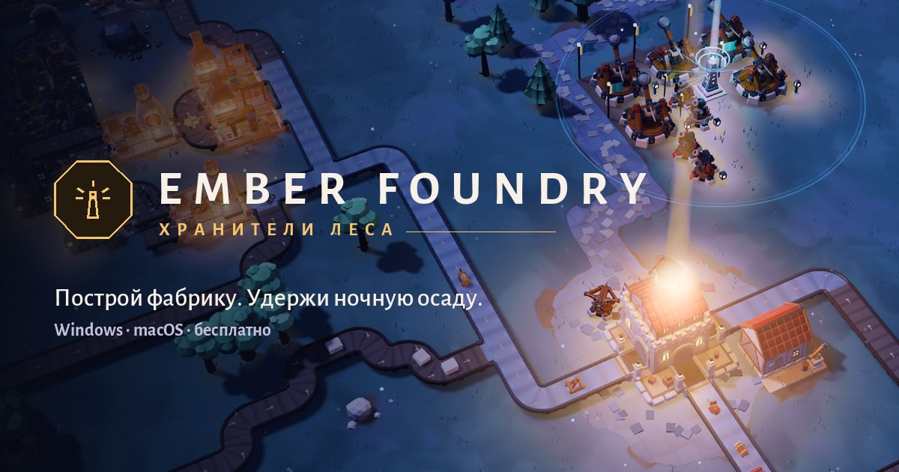
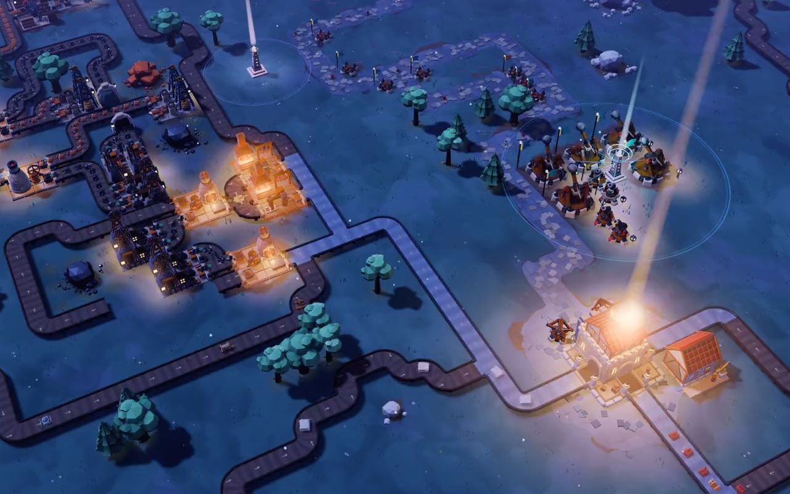
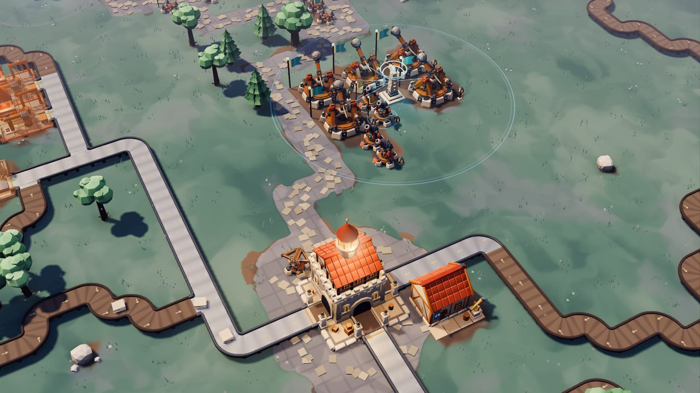
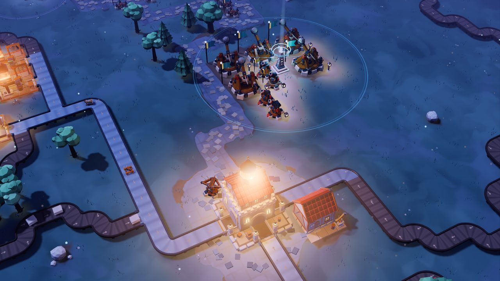
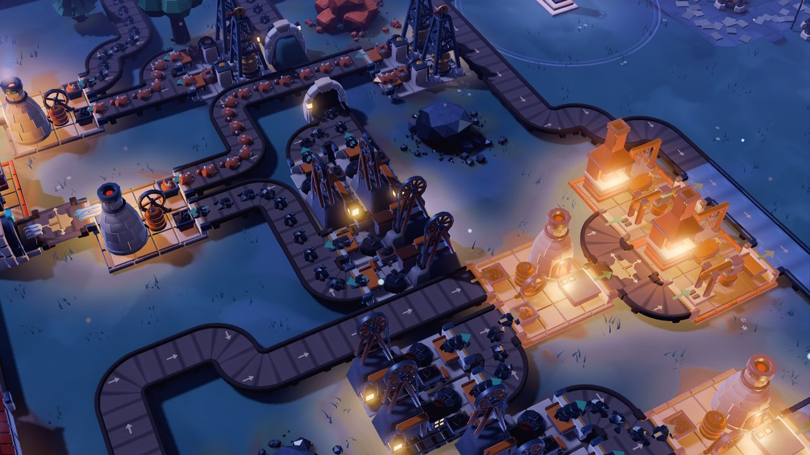
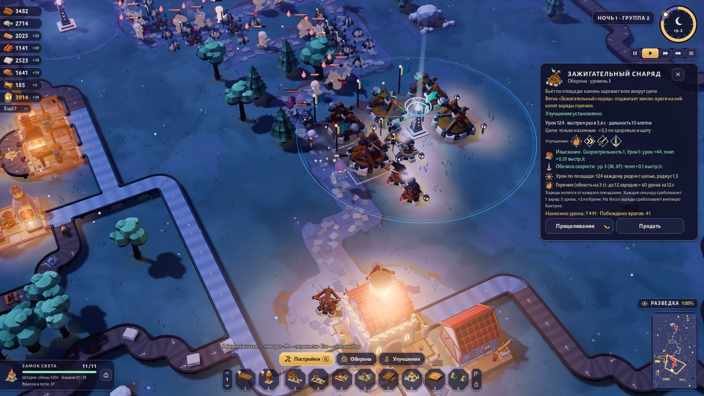
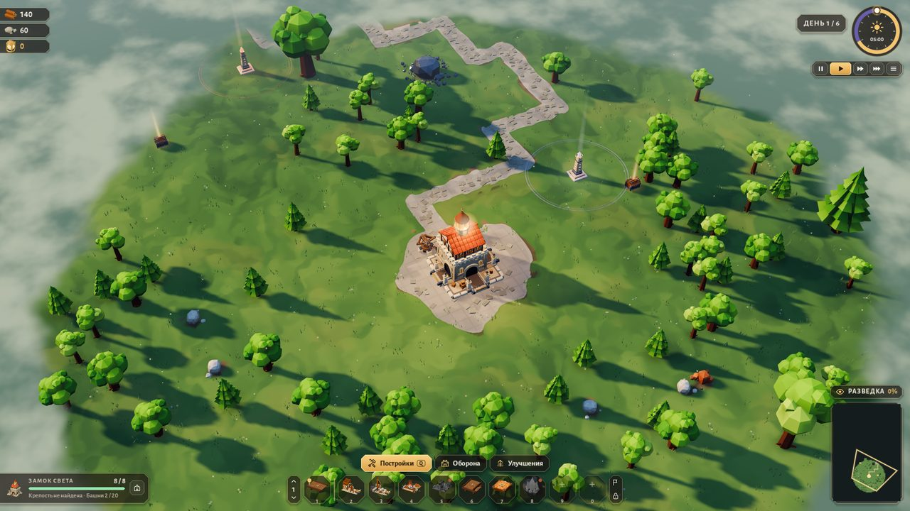
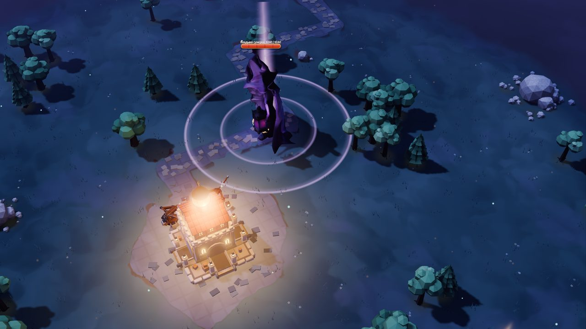

  <a href="https://mazamaka.github.io/ember-foundry-game/?lang=en"><b>Website</b></a> ·
  <a href="https://github.com/mazamaka/ember-foundry-game/releases/latest"><b>Download for Windows &amp; macOS</b></a> ·
  <a href="README.ru.md">Русская версия</a>

# Ember Foundry — Keepers of the Forest

**Build a factory. Hold the night siege.** Ember Foundry is factory building meets tower defense in a forest, made
with Godot 4. By day you fell trees, lay conveyor belts and raise workshops; by night skeletons march down the road to
your castle, and everything you built fights back. Free early build for Windows and macOS; the game is in Russian.

## The game

- **Factory.** Lumberjacks, quarries, mines, sawmills, smelters, charcoal kilns and forges — 28 production and
  logistics buildings. Belts are drawn with the mouse; splitters, mergers, crossings and underground belts route the flow.
  Deposits run dry, so the factory keeps moving.
- **Defense.** 11 tower families with 22 upgrade branches: from crossbows and catapults to a chain harpoon, a Tesla coil
  and a forge hammer. Towers gain experience; the castle sends out militia, archers and knights.
- **Expedition.** Procedural maps hidden in fog of war. Beacons and scouts reveal chests, crystal altars and the enemy
  fortress. Win a region by defeating the sixth night's boss or by storming the fortress. Three regions: Emerald Grove,
  Amber Valley, Dusk Hills.
- **Progression.** Coins from every expedition go into a talent atlas of 119 talents; 6 achievements, 5 save slots,
  post-victory trials and content mods.

## Screenshots

<table>
  <tr>
    <td></td>
    <td></td>
  </tr>
  <tr>
    <td></td>
    <td></td>
  </tr>
  <tr>
    <td></td>
    <td></td>
  </tr>
</table>

All frames are taken from version 0.9.33 by the game's own capture scripts.

## Download

| Platform | Requirements | |
|---|---|---|
| Windows 10 / 11 (64-bit) | Vulkan-capable GPU, ≈700 MB | [Installer](https://github.com/mazamaka/ember-foundry-game/releases/latest) |
| macOS | Apple Silicon with macOS 13+ or Intel with macOS 11+, ≈700 MB | [Disk image](https://github.com/mazamaka/ember-foundry-game/releases/latest) |

The installer is not code-signed yet: if SmartScreen says “Windows protected your PC”, choose *More info → Run anyway*.
The Mac app is not notarized: allow the first launch in *System Settings → Privacy & Security → Open Anyway*
(macOS 15+) or Control-click the app → *Open* (macOS 13–14). Every release lists SHA-256 checksums.

## How it's made

Six weeks from the first prototype (September 15, 2026) to 0.9.33.

- **Godot 4.7**, Forward+ renderer (Vulkan, Metal), about 25,000 lines of GDScript.
- **Code-built art:** buildings are assembled by Blender Python scripts (10,000+ lines) with color baked into vertices;
  368 models in the build.
- **Night look:** lighting, LUT color grading, GPU particles and fog of war tuned against reference games.
- **Sound:** 545 sound files built by a script from licensed recordings.
- **Quality:** 138 automated test scenarios, frame-pacing probes on real player saves.
- **Shipping:** one command builds the Windows installer (Inno Setup) and the macOS disk image (on Windows, via WSL),
  then checks a sandboxed install, first launch and uninstall of the Windows build and smoke-tests the Mac game pack.

## This repository

The game's website (GitHub Pages) and its releases. The game's source code is not public.

- `index.html`, `assets/` — a static site with no build step and no dependencies: vanilla JS for the RU/EN switch, the
  embers canvas, the day/night slider, the fog-of-war reveal, the lightbox and OS-aware downloads.
- `release.json` — the current build: version, files, sizes, SHA-256; the download buttons read it.
- `tools/build_assets.py` — turns the game's press shots and clips into AVIF/WebP/JPEG, H.264 and WOFF2 subsets, and
  draws the link previews.
- `tools/release.py` — publishes a build: a GitHub release with both installers and a fresh `release.json`.

## Credits

Music — Kevin MacLeod (incompetech.com), CC BY 4.0 · Characters — KayKit, CC0 · Fonts — Alegreya, SIL OFL ·
Engine — [Godot](https://godotengine.org), MIT. The full list of authors and licenses is in the game.

© 2026 Ember Foundry
